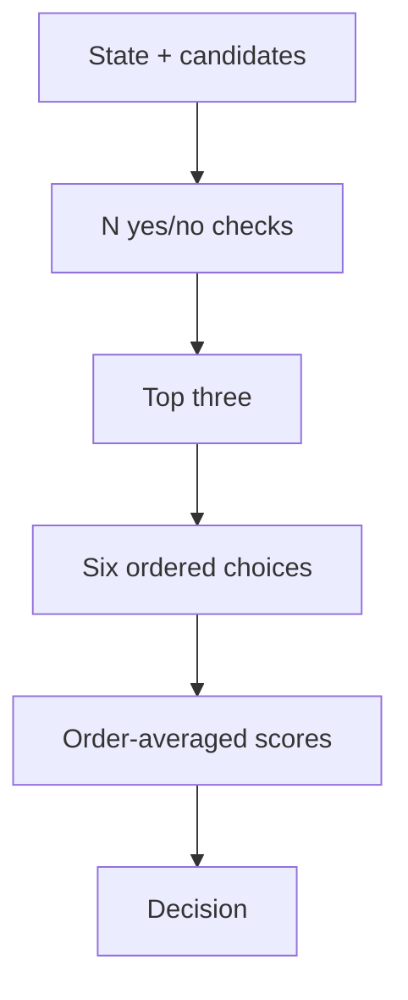

A decision among 100+ possible outcomes is more than a larger multiple-choice question. One choice question must compare many similar options at once; dividing them into groups makes each question smaller but adds dependent inference rounds. We use **binary screening followed by permutation-marginalized reranking**, paired with **prefix-shared, branch-isolated inference**. The decision rule changes *what* is asked; the execution engine reduces repeated computation when many questions share the same state.

Both rounds run on a packed inference engine that shares the state prefix while keeping each question branch isolated.

## The decision rule

For state $x$ and candidate set $C=\{c_1,\ldots,c_N\}$, the first request contains $N$ native binary (`noul`) questions: “Does $c_i$ apply to $x$?” Let $s_i=P(\text{yes}\mid x,c_i)$. These are independent binary answers, **not** a categorical distribution: generally $\sum_i s_i\ne1$. To rank them on a common scale, we normalize their odds across the candidate set:

$$
\begin{aligned}
z_i&=\log\frac{\max(s_i,10^{-9})}{\max(1-s_i,10^{-9})},\\
p_i^{(0)}&=\frac{e^{z_i}}{\sum_{j\in C}e^{z_j}}.
\end{aligned}
$$

Keep the three candidates with the largest $s_i$, forming shortlist $T$. The second request contains every permutation of those candidates: $|S_3|=3!=6$ three-way choice questions. Each candidate ID stays fixed while its *position* changes. If $q_{i,\pi}$ is the choice probability for candidate $i$ under ordering $\pi$, average over orderings and redistribute only the shortlistees' original mass $m=\sum_{i\in T}p_i^{(0)}$:

$$
p_i^{(1)}=
\begin{cases}
m\,\frac{1}{6}\sum_{\pi\in S_3}q_{i,\pi},&i\in T,\\
p_i^{(0)},&i\notin T.
\end{cases}
$$

The final decision is

$$
\hat c=\operatorname*{argmax}_{i\in C}p_i^{(1)}.
$$

The six-way average reduces sensitivity to option order; it cannot recover a correct candidate omitted from the shortlist. Retaining non-finalist mass also means the final winner is not mathematically forced to come from $T$. The reported winning value is a **ranking score, not a calibrated probability of correctness**. Screening and reranking require two dependent outer requests; six questions in the second request are not six HTTP round trips.

## Why the runtime matters

A multi-question API is not automatically a multi-question *execution* primitive. A conventional backend may tokenize and run the entire state-plus-question prompt separately for each of the $N+6$ questions. Batching those prompts improves GPU occupancy, but still repeats state computation. In an earlier stock D3 experiment, that made this approach much slower than a grouped-choice baseline despite using only two API calls.

The experimental D3 engine instead finds the **longest common token prefix** of the rendered questions and packs their variable-length suffixes into isolated branches. For a prefix of $P$ tokens and suffix lengths $Q_1,\ldots,Q_K$, the approximate token counts are:

$$
\begin{aligned}
\text{Repeated:}\quad &\sum_{j=1}^{K}(P+Q_j)=KP+\sum_jQ_j,\\
\text{Packed:}\quad &BP+\sum_jQ_j.
\end{aligned}
$$

where $B$ is the number of token-budget partitions, usually one for a batch that fits. This is a token-processing accounting identity, **not** a wall-time or FLOP speedup formula. Attention, convolution, recurrent state, kernel launch overhead, and memory traffic still matter. The shared prefix is recomputed for the second decision round, and each extra partition repeats it once.

The packed engine runs tokenwise layers over `[prefix | suffix₁ | … | suffixₖ]`. At full-attention layers, a branch attends to shared prefix keys/values and its *own* causal suffix, never another branch; the two attention contributions are joined with their softmax log-normalizers. Convolution reuses only the short prefix halo needed at each branch boundary. Gated DeltaNet carries a compact prefix-derived recurrent state into each separately segmented branch. Thus question-specific states remain isolated without duplicating a state-length cache per question.

There is a critical semantic boundary: stock D3 uses **noncausal full attention**, so state-token representations can depend on the question. Sharing a question-independent prefix requires causalizing those layers. The packed engine is therefore a **separately named experimental model function**, not a prediction-preserving optimization of stock D3. Its numerical parity check is against an *independent causal reference*, not against stock D3. This execution scheme is specific to the tested Qwen3.5/D3 architecture and its kernels; the decision rule itself can be orchestrated over any compatible native binary-and-choice endpoint, but low latency is not guaranteed there.

## What we measured—and what we did not

In a frozen D3 packed-engine run, all **205** cases completed. Among **202** cases with a reference output, binary screening plus reranking agreed on **160/202 (79.2%)**, versus **156/202 (77.2%)** for the grouped-choice baseline with the same experimental model. Median latency was **2.88 s** and p95 **3.92 s**; the baseline measured **2.80 s** and **5.67 s**, respectively. These are end-to-end evaluation timings, not isolated kernel benchmarks. Agreement with a reference output is not ground-truth accuracy, and the four-case difference does not establish a general quality gain. This run also does not show that stock-model decisions would survive causal packing unchanged.

The engineering lesson is to **separate decision decomposition from runtime reuse**. Independent binary evidence can narrow a large candidate set to a small, order-averaged comparison; a compatible packed runtime can then make the screening questions affordable. Measure shortlist recall, correctness against ground truth, score calibration, token-budget splits, and p50/p95 latency separately before using this approach in production.
